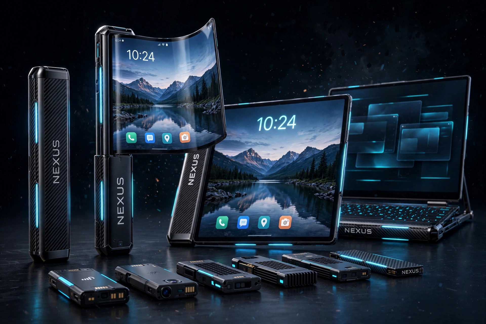
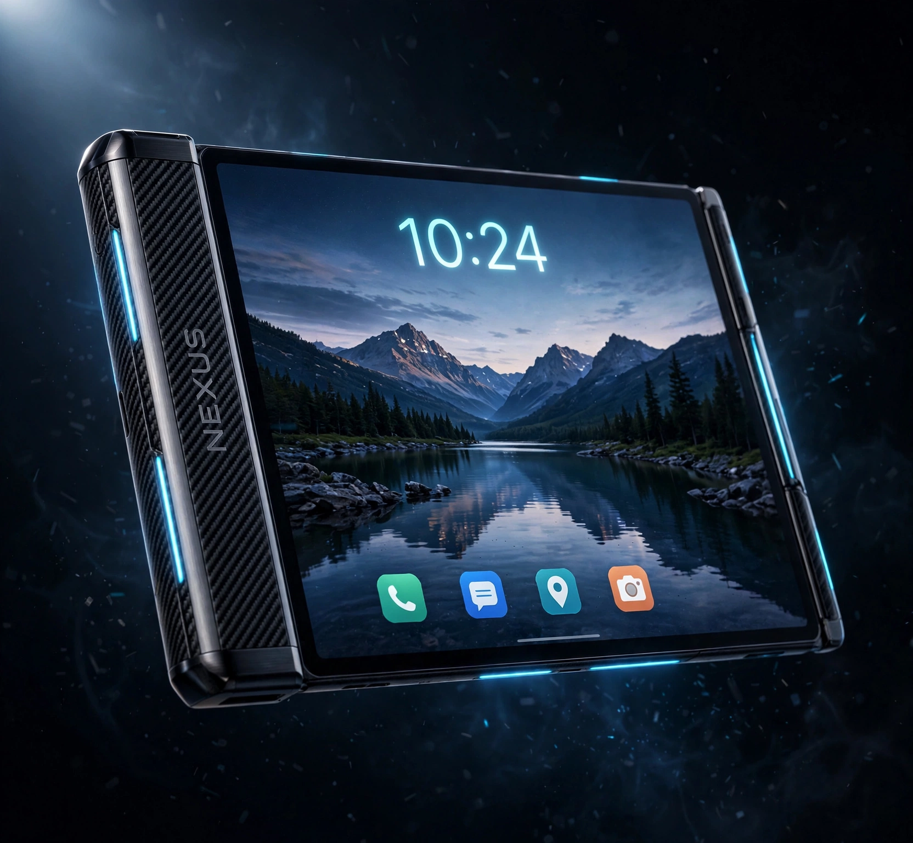
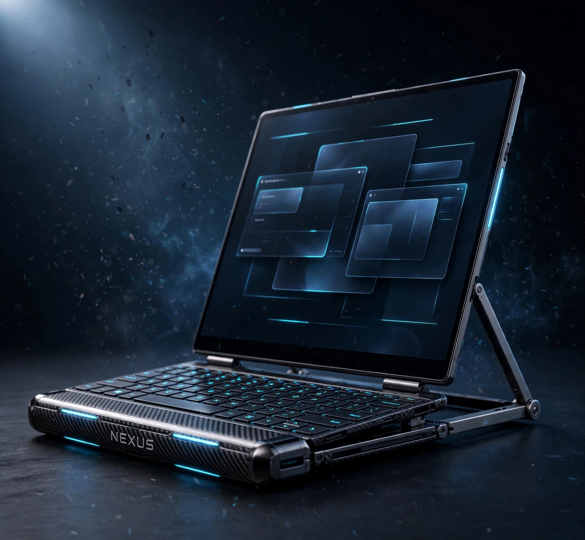

# NEXUS ONE ∞

**STICK. EXPAND. EVOLVE.**

> **A [Nexus](https://github.com/nexus-open) product.** Nexus is an open company: every product is built with everyone, for everyone — humans and AI agents — fully open-sourced and available online. One goal: the future. NEXUS ONE is Product #1.



An open-source, rollable, modular mobile platform. One device that carries as a stick, unrolls into a phone, expands into a tablet, and docks into a laptop — with a family of slide-in modules for power, camera, storage, cooling, sensors, satellite, neural compute, and projection.

**The honesty rule is the project's identity.** Everything in this repo carries one of four labels — **PROVEN IN SIM** (a simulation, checker, or compile ran and its output is in this repo), **DESIGNED** (a parametric design exists and was simulated, no prototype yet), **ASSUMPTION** (a labelled placeholder standing in for an unpublished constant), or **NOT-VERIFIED** (not yet proven). There is no physical prototype yet; this is a complete, simulated, buildable digital blueprint. If a number has no receipt, it says so.

---

## What it is

| | |
|---|---|
| **Form** | ROLL architecture: one flexible AMOLED wraps an internal drum and unrolls sideways. No segments, no telescoping. |
| **Modes** | Stick → phone → tablet (opposed dual-roll) → laptop (keyboard module + kickstand + desktop OS) |
| **Modules** | Magnetic bay: battery, camera pro, storage (4 TB), sensor, cooling, keyboard, neural, satellite, projector |
| **Brain** | Host-brain by default (your phone supplies compute/AI); an own-brain SoM branch is designed |
| **OS** | Nexus OS prototypes + Android launcher (compiled, signed APK) |

## Status — the honest map

**PROVEN IN SIM**
- Stick: 183.9 × 34 × 22 mm · unroll mechanism (R8 drum, negator spring, ≥3 N detents, rack+pinion sync) · 1,001-pose deployment checker
- FPC rolling U-loop · thermal law v1 · pocket fit (RISK accepted) · BLE 5.3 protocol v1.0 (LE Secure Connections, controller is safety owner)
- Module bay: 120×24 rail, 8 pogo pins, 10 W · all firmware sketches compile
- Nexus OS prototypes + Android launcher (compiles clean, signed APK)

**DESIGNED** (parametric, simulated, no prototype yet)
- Tablet mode: opposed dual-roll, 162.9 × 142.8 mm screen, checker PASS 1,001 poses/side — cost: 190 × 46 × 22 mm, 329 g
- Laptop mode: keyboard module (30 keys, 0.5 W), kickstand 0–75° (no tip-over proven), OS desktop mode
- Premium shell: Ti rails + carbon fiber + graphite spreader ply (261.3 g) — with mandatory RF keep-outs
- Cooling / neural / satellite modules · light-field 3D cover (lenticular + eye tracking) · AirScreen mist-projector module · own-brain SoM branch (i.MX95-class, 16 GB)
- Satellite link closes **on paper** (LEO +37.8 dB; GEO L-band +5.6 dB nominal / +2.6 dB floor — marginal-yes; S-band not claimed)

**RESEARCH TRACK** (kept, not promised)
- **True volumetric holography** — gap recomputed UPWARD to ~1000× (938 traps, ~192 W) with an **eye-safety hard blocker**. It stays research, never the product layer.
- **6G service** — antennas are designable; the service does not exist to invent.

**NOT-VERIFIED** (the open-items register: `docs/freeze-v2/OPEN_ITEMS_v2_0.md`, 16 items) — panel roll-cycle rating, bench prototype (parked by rule), F5 hardware validation before the security-branch merge, full-wave RF confirmation, VNA coupon, per-operator satellite figures.

## The four modes

**Stick** — 183.9 × 34 × 22 mm, 261.3 g (v2 graphite shell), 13.7 Wh (2 × 6.85 Wh), 28 mm status strip.

**Phone** — one panel unrolls to **162.9 × 71.5 mm**. Length conserved to 0.000 mm across 1,001 deployment poses, bend radius R8 held everywhere.



**Tablet** — opposed dual-roll: the untouched phone mechanism + a second drum give a **162.9 × 142.8 mm** screen. Same panel, second axis. (Variant device: 190 × 46 × 22 mm, 329 g.)



**Laptop** — keyboard module docks on the bay rail (bay ID 6, 33 kΩ), kickstand deploys to ~70°, Nexus OS switches to a desktop mode (3 windows, brightness auto-capped to hold the 3 W open law).

## Key frozen numbers

- Stick: **183.9 × 34 × 22 mm**, **261.3 g** (graphite shell config)
- Screen: **162.9 × 71.5 mm** flexible AMOLED class (6.67″ 2400×1080), unrolls sideways, bend R8
- Tablet variant: **190 × 46 × 22 mm, 329 g**, screen **162.9 × 142.8 mm**
- Battery: **13.7 Wh** (2 × 6.85 Wh); idle 0.30 W → 45.7 h stick
- Thermal law v2: folded ≤0.9 W @25 °C; hot-day derate ~0.5 W; 2 W folded only with cooling module docked
- Module bay: 120×24 rail, 8 pogo pins, 10 W max, identify-before-power contract
- 9 modules: battery (+10 Wh) · camera pro (200MP-class periscope) · storage (dual 2TB = 4 TB) · sensor · cooling (folded Rth 8.8→2.58 K/W) · keyboard · neural (USB2 NPU) · satellite (MT6825-class NTN) · projector (AirScreen, ID pending)
- v2.0 design freeze: [`docs/freeze-v2/FROZEN_PARAMETERS_v2_0.md`](docs/freeze-v2/FROZEN_PARAMETERS_v2_0.md)

## How it works (30 seconds)

The phone's screen is a flexible panel wound on a 16 mm drum inside the stick. Pull the leading bar and the panel unrolls out of a slot — a constant-force negator spring counterbalances it, magnetic detents lock it open and closed, and a rolling U-loop ribbon cable keeps the display connected through the whole motion. No hinge, no fold crease, no stacked sections. The back of the stick carries a magnetic module rail with pogo pins: snap on a battery, a camera, a keyboard, and the phone becomes something else.

## Project structure

```
├── README.md                 you are here
├── LICENSING.md              which license covers what
├── LICENSE                   GPLv3 (firmware / software / OS code)
├── LICENSE-HARDWARE          CERN-OHL-S v2 (hardware designs, CAD, docs)
├── CONTRIBUTING.md           how to help — "numbers need receipts"
├── ROADMAP.md                milestones + the 16 open items
├── LAUNCH_POST_DRAFT.md      announcement drafts (not posted)
├── CODE_OF_CONDUCT.md        Contributor Covenant 2.1
├── cad/                      OpenSCAD sources (roll v0.6/v0.7, superseded MECH-B)
├── firmware/
│   ├── v1-controller/        ESP32-S3 spine controller (v1.6, compiles)
│   ├── v1-modules/           battery / camera / sensor / storage sketches
│   ├── v2-modules/           cooling / keyboard / neural / satellite sketches
│   └── v2.1-security-branch/ patched controller (5 Highs fixed; merge gated)
├── os/
│   ├── prototypes/           Nexus OS HTML prototypes + desktop mode (open in a browser)
│   └── android-launcher/     Kotlin BLE client + launcher, signed debug APK
├── renders/                  tablet, laptop, full-lineup, hero (CC BY-SA 4.0)
├── research/                 hologram system design (incl. the ~1000× gap math)
├── vision/                   the vision boards that started everything
└── docs/
    ├── freeze-v2/            the v2.0 DESIGN FREEZE (parameters, BOM delta, open items, vision map v2.1)
    ├── v2-studies/           tablet · laptop · modules · own-brain · hologram · materials · security review · roadmap · verification evidence
    ├── v2.1/                 thermal model B8 · firmware security branch · RF study B6
    ├── v1-history/           design versions v0.2–v1.7, digital validation, master index
    └── BENCH_PLAN.md         the community prototype program (B1–B6)
```

The firmware builds with arduino-cli + ESP32 core 3.3.12; the APK route is documented in `os/android-launcher/`. Every simulation ships its source and its stdout evidence next to it.

## How to contribute

Read [CONTRIBUTING.md](CONTRIBUTING.md). The short version: this is a **digital-first** project — CAD, simulations, firmware, and analysis are the work. The prototype program lives in [docs/BENCH_PLAN.md](docs/BENCH_PLAN.md). The house rule is **numbers need receipts**: every claim ships with its checker output, compile log, or calculation. Keep the labels honest — PROVEN IN SIM / DESIGNED / ASSUMPTION / NOT-VERIFIED.

## Roadmap

[ROADMAP.md](ROADMAP.md) — milestones from the open-items register: community prototype (bench B1–B6), the panel-durability rig (the #1 unknown), the security-branch merge after hardware validation, satellite operator data, and the standing research tracks.

## Licensing

- **Hardware designs, CAD, mechanics, docs:** [CERN Open Hardware Licence v2 — Strongly Reciprocal](LICENSE-HARDWARE)
- **Firmware, OS code, software:** [GNU General Public License v3](LICENSE)
- **Renders, images, vision boards:** CC BY-SA 4.0

Details: [LICENSING.md](LICENSING.md). The reciprocal hardware license is deliberate: nobody can take this design closed and sell it — improvements stay open.

## Origin

**Created by Fabulous — designed and simulated entirely on a phone, with AI assistance.** One phone, no laptop, zero budget: the whole thing (mechanics, simulations, firmware, OS, renders) was built digitally from a single concept poster. The story is part of the project — keep it honest and keep it open.
